

  

<h1 align="center">APonte</h1>

  <b>One mouse and one keyboard for several Windows computers on the same network.</b> 
  With copy and paste, file sending and the other computer's screen.

  
  
  
  

  <a href="README.md">Português</a> · <b>English</b>

  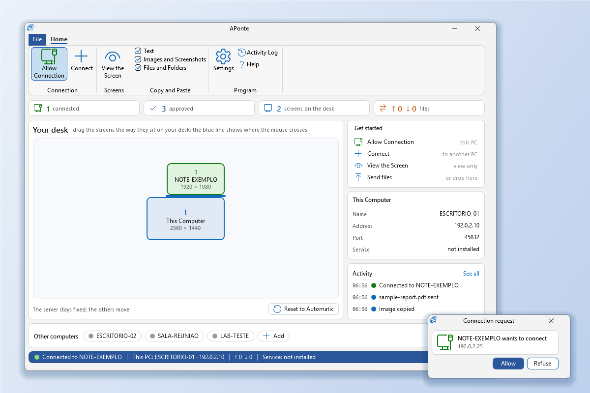

<h3 align="center">
  <a href="https://github.com/Dorflex-DD/APonte/releases/latest">⬇ Download the latest version (GitHub)</a>
  &nbsp;·&nbsp;
  <a href="https://gitlab.com/fabioffg/APonte/-/releases/permalink/latest">⬇ Download (GitLab)</a>
</h3>

> ⚠️ **Notice:** on weekends (Saturday and Sunday) all access is closed.
>
> **Free to use, only with the author's written permission.** See [License](#license).

## Download

The two addresses above always open the latest version. Each version has four packages for Windows x64:

| Package | File | For whom |
|---|---|---|
| **Installer, with runtime** | `APonte_v…_instalador_com-runtime.msi` | Recommended. Already includes .NET 11. |
| Installer, without runtime | `APonte_v…_instalador_sem-runtime.msi` | Smaller. Uses the .NET Desktop Runtime 11 x64 already installed. |
| Portable, with runtime | `APonte_v…_executavel_com-runtime.zip` | No installation: extract and open. Already includes .NET 11. |
| Portable, without runtime | `APonte_v…_executavel_sem-runtime.zip` | No installation and smaller. Uses the .NET Desktop Runtime 11 x64 already installed. |

Download from [GitHub › latest version](https://github.com/Dorflex-DD/APonte/releases/latest) or [GitLab › latest version](https://gitlab.com/fabioffg/APonte/-/releases/permalink/latest). Next to the packages you will find the version history (`CHANGELOG.en.txt`), the readme and the `SHA256.txt` checklist with its signature.

## What it does

- **Shared mouse and keyboard.** Move the pointer to the edge of the screen and it crosses to the other computer; the keyboard follows. `Ctrl+Alt+Pause` gives control back to the local computer.
- **Your desk.** Drag the other computers' screens to where they really sit on your desk: beside, above, below or unaligned. It works with several monitors, a blue line shows where the mouse crosses, and the position is saved.
- **Copy and paste between computers.** Text, images and screenshots, files and folders. Each kind can be turned on or off.
- **Send files.** Drag them onto the APonte window, pick them with the file chooser or use the APonte item in the File Explorer right-click menu.
- **View the other computer's screen.** In a window, one monitor or all of them, also in full screen.
- **Connection only with approval.** Each new computer has to be approved once. You can forget one approved computer or all of them.
- **Windows service.** With the installer, control also works on the Windows sign-in screen.
- **Updates from the app itself.** APonte tells you when there is a new version, downloads and installs it. Packages are checked against a signed SHA-256 list.
- **Backup.** Import and export the settings.
- **Activity log and diagnostics.** History of connections, files and errors, with search and filters, plus a diagnostics package.
- **Portuguese and English**, light or dark theme, accent color and interface size.
- **Near the clock.** APonte can start with Windows, keep running in the icon next to the clock and reconnect by itself.

## Getting started

1. **Install APonte** on the computers, all on the same network.
2. On the computer whose mouse and keyboard you will use, click **Allow Connection**. On each of the others, click **Connect**, type the name or address of the first one and say which side it sits on.
3. **Approve the request** that appears and, if you like, drag the screens in **Your desk** so they match your real desk. Done: move the mouse to the edge.

## Screenshots

All images are from version 1.6.141, with sample data.

  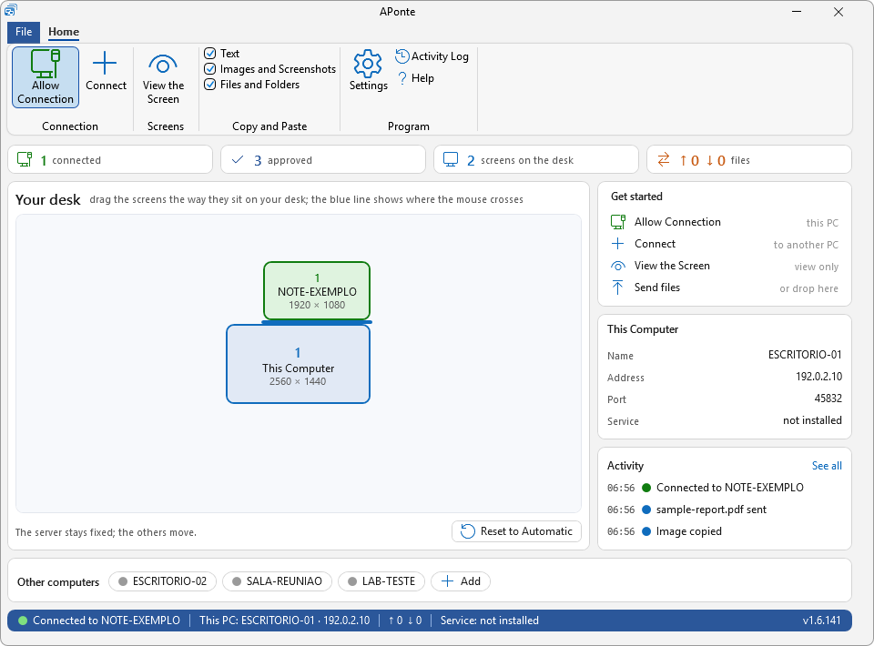 
  <b>Your desk</b> with one computer connected: counters, shortcuts to get started, this computer's details and activity.

  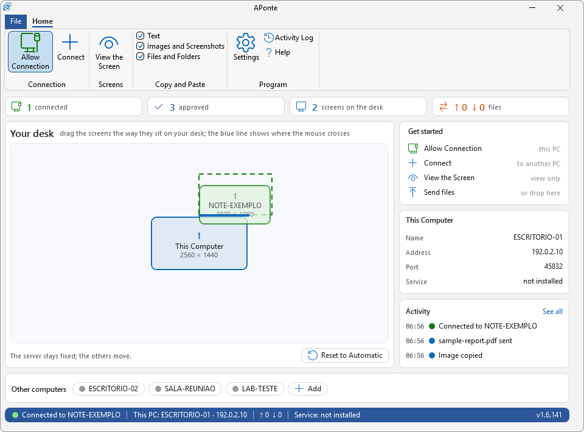 
  <b>Dragging a screen</b> to where it sits on the desk. The blue line shows where the mouse crosses.

  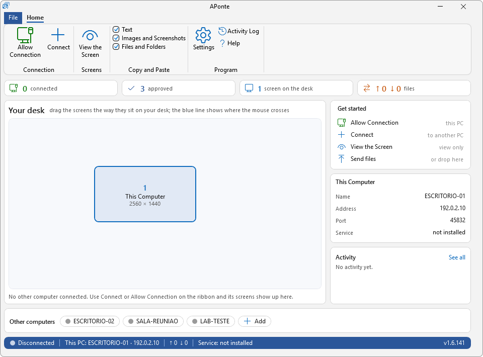 
  <b>Not connected</b>: the computers already approved are one click away, in <i>Other computers</i>.

  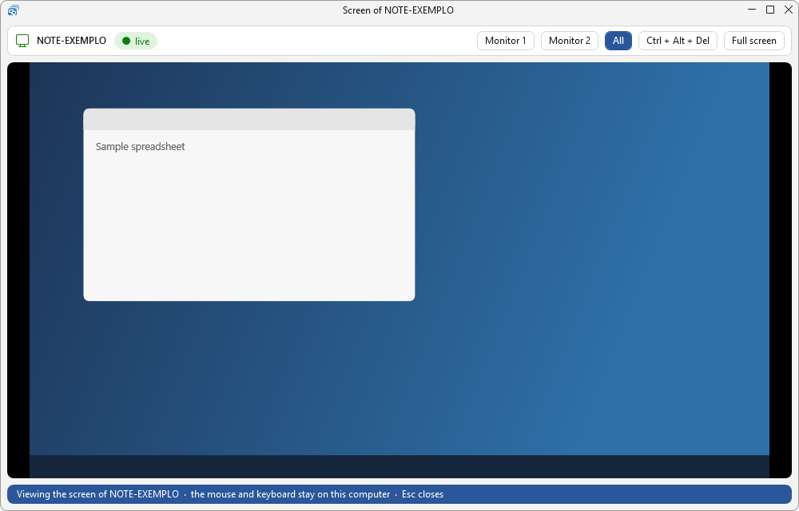 
  <b>View the Screen</b>: one monitor or all of them, with full screen.

| | |
|:---:|:---:|
| 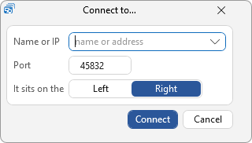 <b>Connect</b>: name or address, port and which side the other one sits on. | 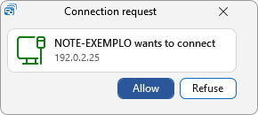 <b>Connection request</b>: only those you allow get in. |
| 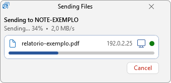 <b>Send files</b> with progress and speed. | 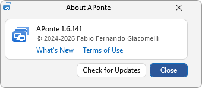 <b>About</b>: version, what's new, terms and update check. |
| 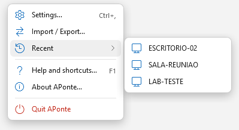 <b>File menu</b> with the recent computers. | 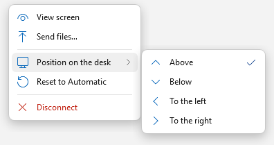 <b>Right-click</b> on a screen of the desk. |
| 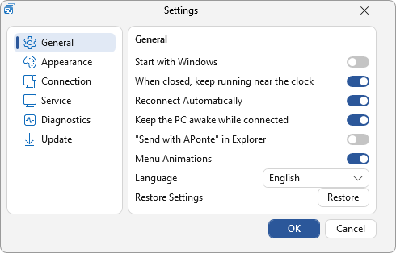 <b>Settings › General</b> | 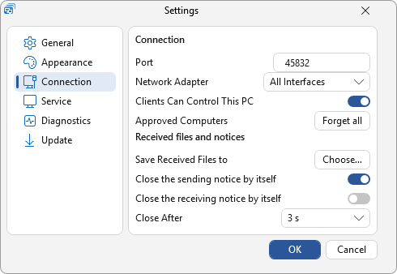 <b>Settings › Connection</b> |
| 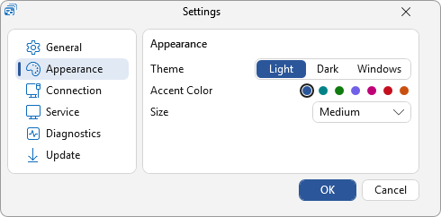 <b>Settings › Appearance</b>: theme, color and size. | 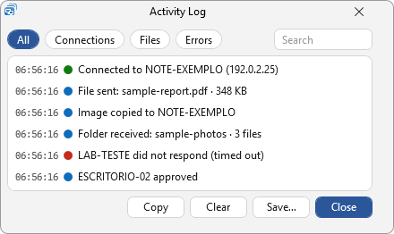 <b>Activity Log</b> with search and filters. |

## Requirements

- Windows 10 or 11 (64-bit).
- Computers on the same network.
- [.NET Desktop Runtime 11 x64](https://dotnet.microsoft.com/download/dotnet/11.0), **only** for the `sem-runtime` (without runtime) packages. The `com-runtime` (with runtime) packages already include .NET 11.

The installer opens in Portuguese. For English, run `msiexec /i "file.msi" TRANSFORMS=:1033`.

## Updates

- APonte tells you when there is a new version and updates itself (**Settings › Update** or **About › Check for Updates**). The check can be turned off in Settings.
- Updating keeps the settings and the approved computers.
- If you use 1.6.125, 1.6.126 or 1.6.127 with only .NET 10, first install the [.NET Desktop Runtime 11 x64](https://dotnet.microsoft.com/download/dotnet/11.0) or download the `com-runtime` package in the same format you already use.
- **Portable, by hand:** close APonte, delete everything in its folder except the `dados` folder, and extract the new package. Never extract over the old files.
- The full version history comes with each version (`CHANGELOG.en.txt`; in Portuguese, `CHANGELOG.txt`).

## Security and privacy

- **Local network.** The computers talk directly to each other, over your network. There is no account or sign-up.
- **Approval.** A new computer only gets in after you allow it. Name and address are not enough: each computer has its own identity, checked on every connection, and the connection between them is encrypted.
- **Checked updates.** Before installing a new version, APonte checks the packages against a SHA-256 list signed by the author.
- **Your data stays with you.** APonte stores its data only in its own folder and does not send information to the author. The new-version check only queries the public release address.

## License

**Free to use, only with the author's written permission.**
Ask for permission **by e-mail only**: **fabio.s91@icloud.com**, with the app name in the subject: **APonte**.
Companies need their own permission. You may not modify it, copy it to other people or sell it.
Use without permission is subject to a fine and compensation. Full Terms of Use in [LICENSE](LICENSE) (in Portuguese); the English text, `TERMOS-DE-LICENCA-DE-USO.en.txt`, comes inside each package.

Third-party libraries remain under their own licenses, listed in the `Licencas` folder of each package.

## Author

Fabio Fernando Giacomelli

© 2024-2026 Fabio Fernando Giacomelli. All rights reserved.
