
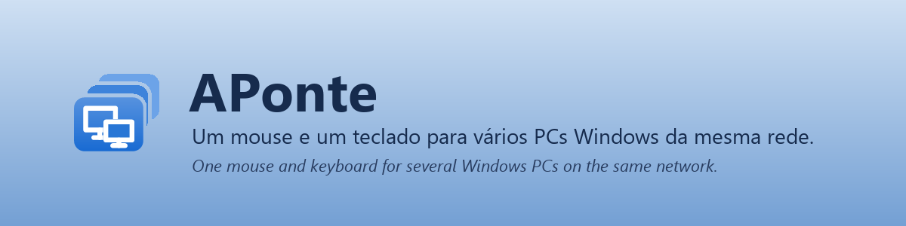

   

<b>Use um mouse e um teclado em vários PCs Windows, como se fossem uma mesa só.</b> <i>Use one mouse and keyboard across several Windows PCs, as if they were one desk.</i>

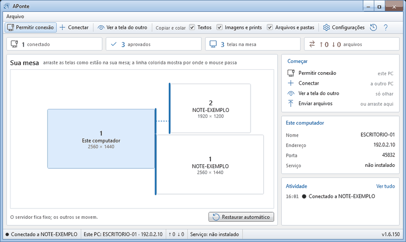

## O que é / What it is
O APonte liga os PCs Windows da mesma rede: o ponteiro passa da borda de uma tela para o outro computador e o teclado vai junto. Ele também copia e cola textos, imagens e arquivos entre os PCs, envia arquivos e mostra a tela do outro computador. Para quem trabalha com dois ou mais computadores na mesma mesa.
*APonte links the Windows PCs on the same network: the pointer crosses from the edge of one screen to the other computer and the keyboard follows. It also copies and pastes text, images and files between the PCs, sends files and shows the other computer's screen. For anyone working with two or more computers on the same desk.*

## Destaques / Highlights
| | |
|---|---|
| **Sua mesa** — arraste as telas para onde elas estão de verdade; a linha colorida mostra por onde o mouse passa. *Your desk — drag the screens to where they really sit; the colored line shows where the mouse crosses.* | 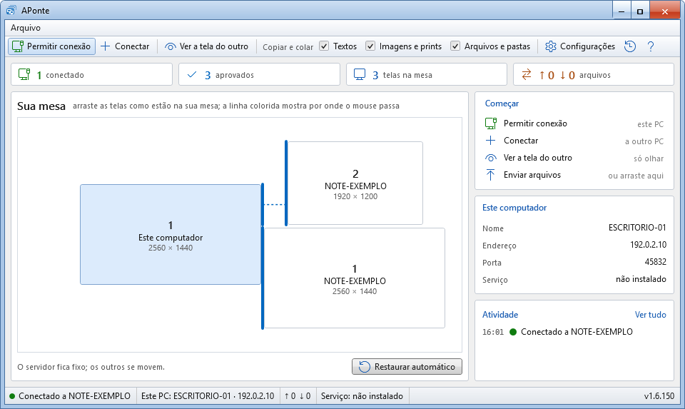 |
| **Cliente e servidor juntos** — no cliente, a mesa mostra também as telas do servidor, ao vivo. *Client and server together — on the client, the desk also shows the server's screens, live.* | 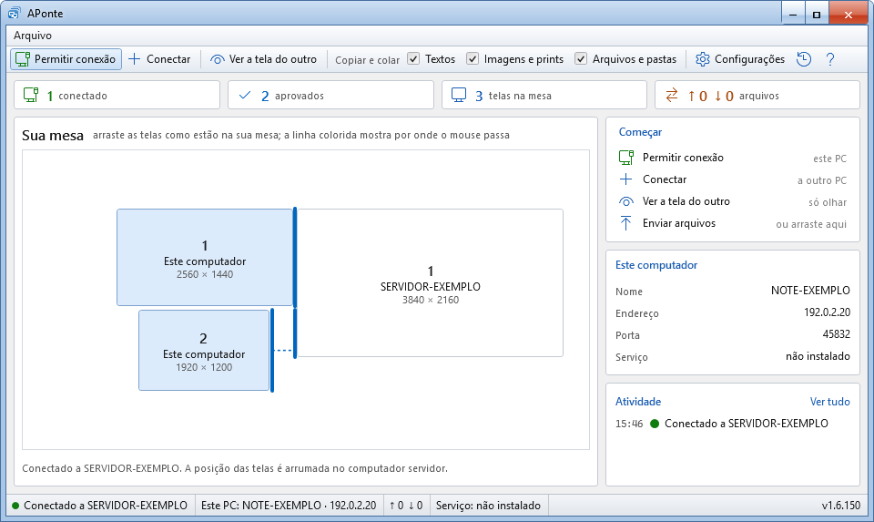 |
| **Visual do Windows 7** — Windows 7 Basic com 10 cores ou Windows Clássico, em um clique. *Windows 7 look — Windows 7 Basic in 10 colors or Windows Classic, in one click.* | 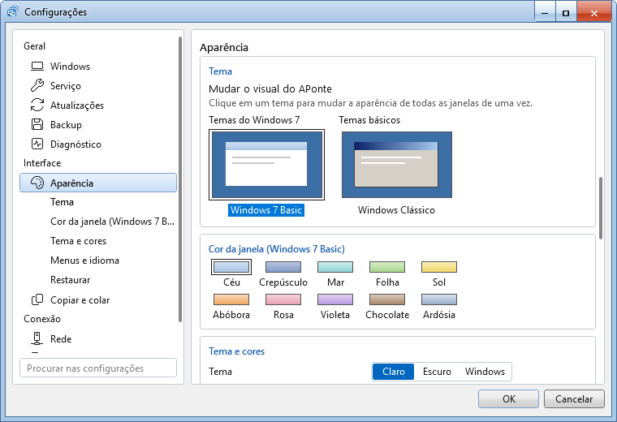 |

## Como funciona / How it works
1. Instale o APonte (ou abra o portátil) nos PCs. / *Install APonte (or open the portable version) on the PCs.*
2. Num PC clique em **Permitir conexão**; no outro, em **Conectar**, e aprove o pedido uma vez. / *On one PC click **Allow Connection**; on the other, **Connect**, and approve the request once.*
3. Arraste as telas na **Sua mesa** e leve o mouse até a borda: ele passa para o outro PC. / *Drag the screens on **Your desk** and move the mouse to the edge: it crosses to the other PC.*

## Funcionalidades / Features
| Recurso / Feature | O que faz / What it does |
|---|---|
| Mouse e teclado / Mouse and keyboard | O ponteiro passa pela borda da tela; o teclado acompanha. `Ctrl+Alt+Pause` devolve o controle. / *The pointer crosses at the screen edge; the keyboard follows.* |
| Sua mesa / Your desk | Telas arrumadas como na mesa, monitor a monitor, nos 4 lados; passagem por monitor. / *Screens arranged like your desk, monitor by monitor, on all 4 sides.* |
| Copiar e colar / Copy and paste | Textos, imagens e prints, arquivos e pastas entre os PCs. / *Text, images, screenshots, files and folders between PCs.* |
| Enviar arquivos / Send files | Arraste para a janela ou use o item do APonte no menu do Explorador. / *Drag onto the window or use the APonte item in File Explorer.* |
| Ver a tela do outro / View the other screen | Numa janela, por monitor ou em tela cheia. / *In a window, per monitor or full screen.* |
| Só com aprovação / Approval only | Cada computador novo é aprovado uma vez; conexão cifrada. / *Each new computer is approved once; encrypted connection.* |
| Serviço do Windows / Windows service | Funciona também na tela de entrada do Windows. / *Also works on the Windows sign-in screen.* |
| Atualização / Updates | O próprio app baixa e instala, conferindo uma lista assinada. / *The app downloads and installs updates, checked against a signed list.* |
| Temas / Themes | Windows 7 Basic (10 cores) ou Windows Clássico; tema claro e escuro. / *Windows 7 Basic (10 colors) or Windows Classic; light and dark.* |

## Galeria / Gallery
| | |
|---|---|
|  Janela principal sem conexão / *Main window, not connected* | 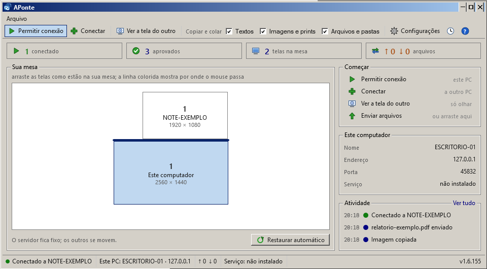 Tema Windows Clássico / *Windows Classic theme* |
| 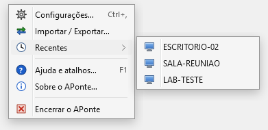 Menu Arquivo no estilo Windows 7 / *File menu, Windows 7 style* | 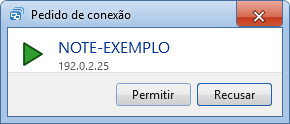 Pedido de conexão / *Connection request* |
| 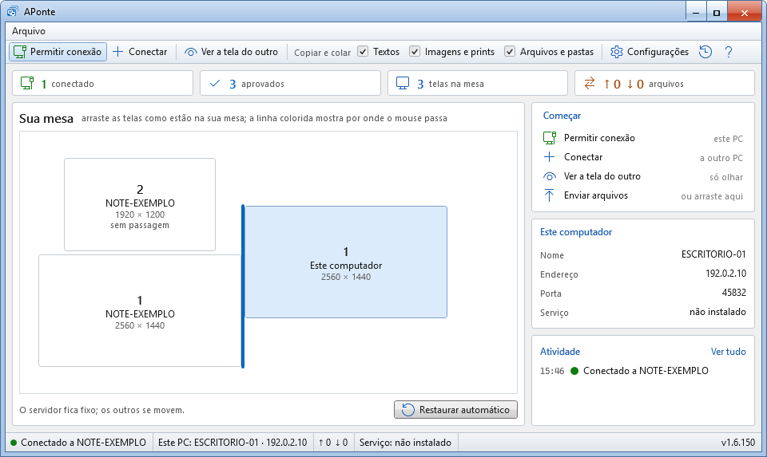 Passagem por monitor desligada / *Crossing turned off on one monitor* | 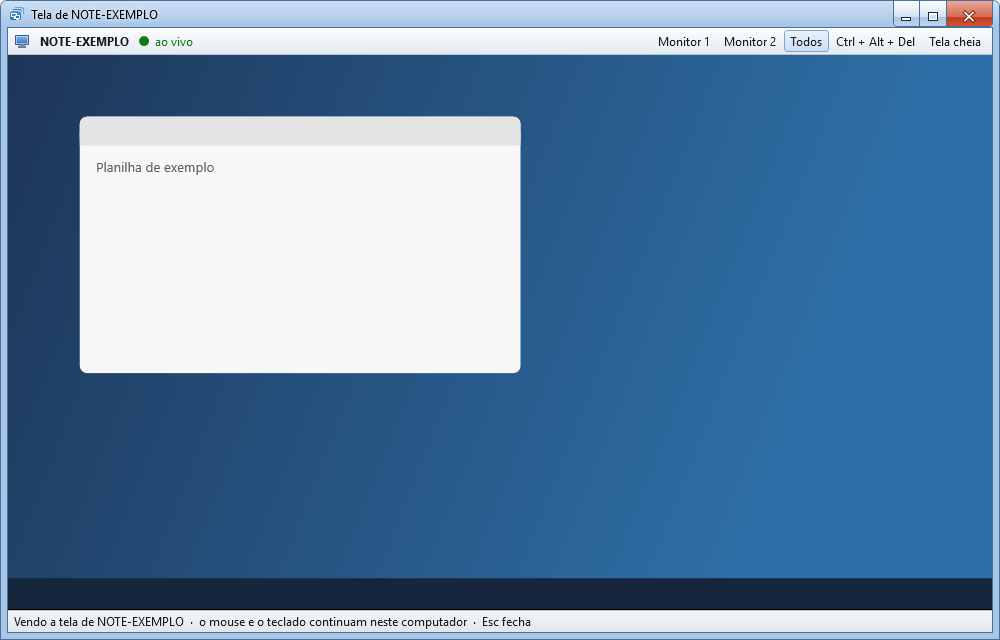 A tela do outro computador / *The other computer's screen* |
| 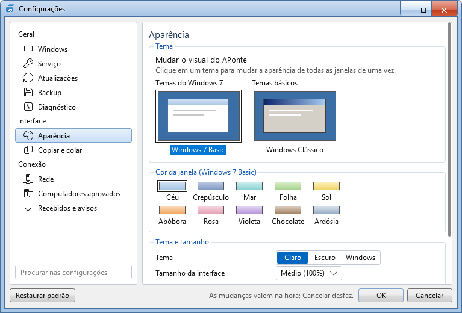 Configurações com busca / *Settings with search* | 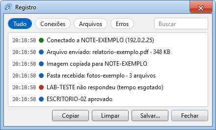 Registro de atividade / *Activity log* |
| 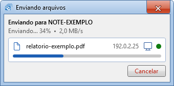 Enviando arquivos / *Sending files* | 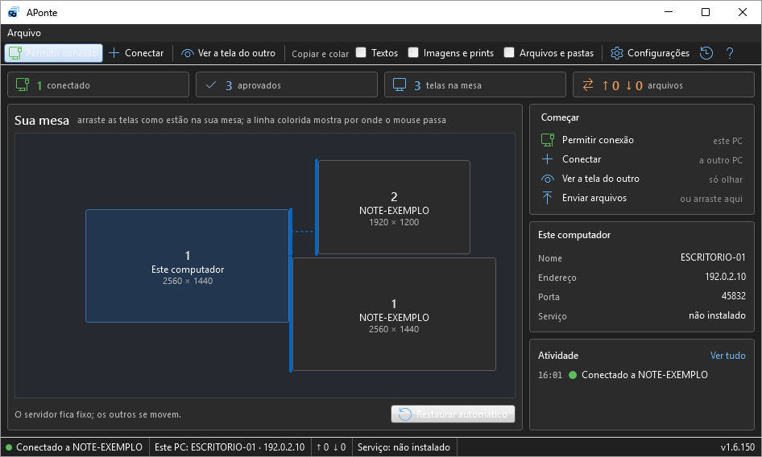 Tema escuro / *Dark theme* |

## Baixar / Download
- [Instalador e portátil — versão mais nova / Installer and portable — latest version](https://github.com/Dorflex-DD/APonte/releases/latest)

Windows 10/11 x64 · .NET 11 Desktop Runtime x64. Dois pacotes por versão: instalador `.msi` e portátil `.zip`. / *Two packages per version: `.msi` installer and portable `.zip`.*

## Novidades / What's new — v1.6.155
- Ícones coloridos e botões do título no jeito do Windows 7 em todo o app. / *Windows 7 style color icons and title buttons throughout the app.*
- Janela principal com grupos do Windows 7 no lugar dos cartões brancos. / *Main window with Windows 7 groups instead of white cards.*
- Configurações uma página por vez, com grupos e "Restaurar padrão" no rodapé. / *Settings one page at a time, with groups and "Restore defaults" at the bottom.*

© 2024-2026 Fabio Fernando Giacomelli. Uso somente com autorização escrita do autor. / Use only with the author's written authorization.
