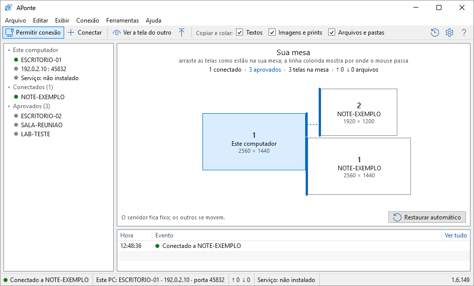
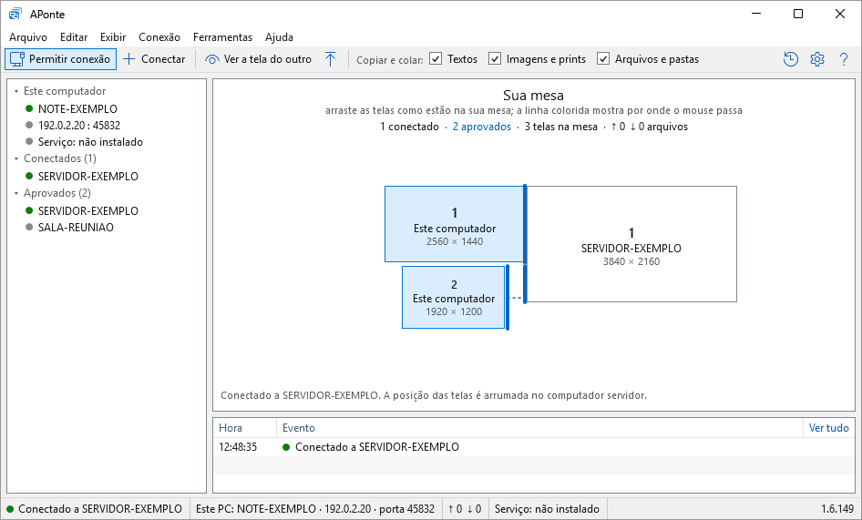

# APonte

Um mouse e um teclado para vários PCs Windows da mesma rede, com copiar e colar, arquivos e a tela do outro. / One mouse and keyboard for several Windows PCs on the same network, with copy and paste, files and the other PC's screen.

## Baixar / Download — v1.6.149

- [Instalador / Installer (.msi)](https://github.com/Dorflex-DD/APonte/releases/download/v1.6.149/APonte_v1.6.149_instalador_com-runtime.msi)
- [Portátil / Portable (.zip)](https://github.com/Dorflex-DD/APonte/releases/download/v1.6.149/APonte_v1.6.149_executavel_com-runtime.zip)

Windows 10/11 x64 · .NET 11

## Novidades / What's new

- Aparência de programa do Windows: menu clássico, barra de ferramentas e barra de status. / Windows-program look: classic menu, toolbar and status bar.
- Lista dos computadores à esquerda e atividade em lista. / Computer list on the left and activity as a list.
- Sua mesa com telas maiores; ao arrastar, ela se afasta para caber. / Bigger screens on Your desk; it zooms out while dragging.
