

  

<h1 align="center">APonte</h1>

  <b>Um mouse e um teclado para vários computadores Windows da mesma rede.</b> 
  Com copiar e colar, envio de arquivos e a tela do outro computador.

  
  
  
  

  <b>Português</b> · <a href="README.en.md">English</a>

  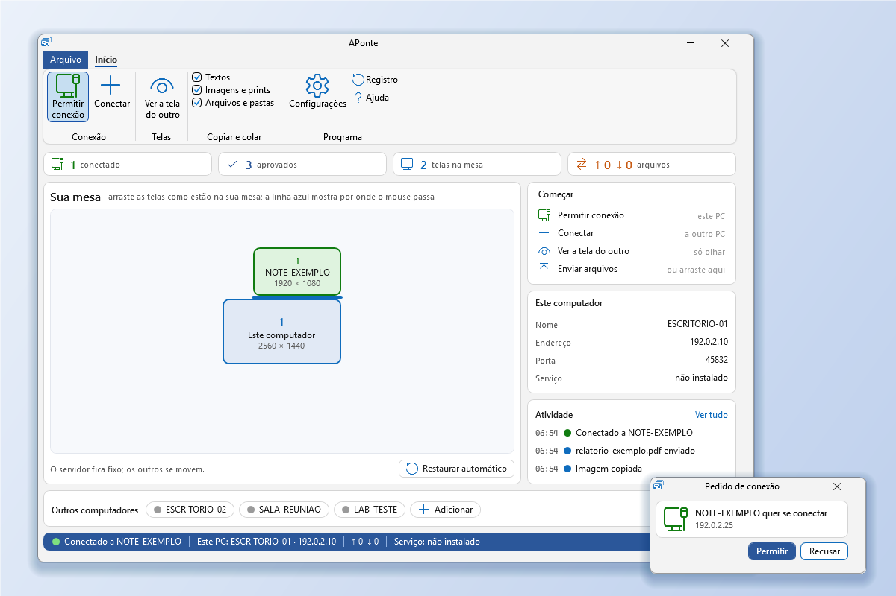

<h3 align="center">
  <a href="https://github.com/Dorflex-DD/APonte/releases/latest">⬇ Baixar a versão mais recente (GitHub)</a>
  &nbsp;·&nbsp;
  <a href="https://gitlab.com/fabioffg/APonte/-/releases/permalink/latest">⬇ Baixar (GitLab)</a>
</h3>

> ⚠️ **Aviso:** aos finais de semana (sábado e domingo) qualquer acesso fica fechado.
>
> **Uso gratuito, somente com autorização por escrito do autor.** Veja [Licença](#licença).

## Download

Os dois endereços acima sempre abrem a versão mais recente. Em cada versão há quatro pacotes para Windows x64:

| Pacote | Arquivo | Para quem |
|---|---|---|
| **Instalador, com runtime** | `APonte_v…_instalador_com-runtime.msi` | Recomendado. Já inclui o .NET 11. |
| Instalador, sem runtime | `APonte_v…_instalador_sem-runtime.msi` | Menor. Usa o .NET Desktop Runtime 11 x64 já instalado. |
| Portátil, com runtime | `APonte_v…_executavel_com-runtime.zip` | Sem instalar: descompacte e abra. Já inclui o .NET 11. |
| Portátil, sem runtime | `APonte_v…_executavel_sem-runtime.zip` | Sem instalar e menor. Usa o .NET Desktop Runtime 11 x64 já instalado. |

Baixe em [GitHub › versão mais recente](https://github.com/Dorflex-DD/APonte/releases/latest) ou em [GitLab › versão mais recente](https://gitlab.com/fabioffg/APonte/-/releases/permalink/latest). Junto dos pacotes ficam o histórico de versões (`CHANGELOG.txt`), o leia-me e a lista de conferência `SHA256.txt` com a assinatura.

## O que ele faz

- **Mouse e teclado compartilhados.** Leve o ponteiro até a borda da tela e ele passa para o outro computador; o teclado acompanha. `Ctrl+Alt+Pause` devolve o controle ao computador local.
- **Sua mesa.** Arraste as telas dos outros computadores para onde elas estão de verdade na sua mesa: ao lado, acima, abaixo ou desalinhadas. Funciona com vários monitores, uma linha azul mostra por onde o mouse passa e a posição fica salva.
- **Copiar e colar entre os computadores.** Textos, imagens e prints, arquivos e pastas. Cada tipo pode ser ligado ou desligado.
- **Enviar arquivos.** Arraste para a janela do APonte, escolha pelo seletor de arquivos ou use o item do APonte no menu do botão direito do Explorador de Arquivos.
- **Ver a tela do outro computador.** Numa janela, por monitor ou todos juntos, também em tela cheia.
- **Conexão só com aprovação.** Cada computador novo precisa ser aprovado uma vez. Dá para esquecer um computador aprovado ou todos.
- **Serviço do Windows.** Com o instalador, o controle funciona também na tela de entrada do Windows.
- **Atualização pelo próprio app.** O APonte avisa quando há versão nova, baixa e instala. Os pacotes são conferidos por uma lista SHA-256 assinada.
- **Backup.** Importar e exportar as configurações.
- **Registro e diagnóstico.** Histórico de conexões, arquivos e erros, com busca e filtros, e pacote de diagnóstico.
- **Português e inglês**, tema claro ou escuro, cor de destaque e tamanho da interface.
- **Perto do relógio.** O APonte pode iniciar com o Windows, continuar no ícone ao lado do relógio e reconectar sozinho.

## Como começar

1. **Instale o APonte** nos computadores, todos na mesma rede.
2. No computador cujo mouse e teclado você vai usar, clique em **Permitir conexão**. Em cada um dos outros, clique em **Conectar**, digite o nome ou o endereço do primeiro e diga de que lado ele fica.
3. **Aprove o pedido** que aparece e, se quiser, arraste as telas na **Sua mesa** para deixá-las como estão na sua mesa de verdade. Pronto: leve o mouse até a borda.

## Imagens

Todas as imagens são da versão 1.6.141, com dados de exemplo.

  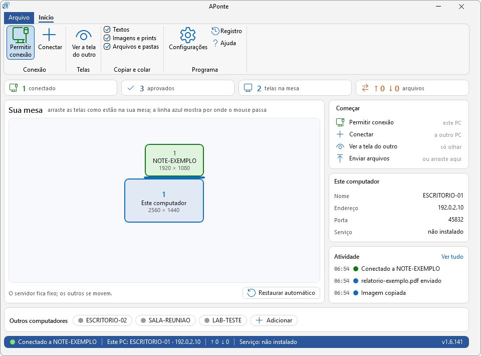 
  <b>Sua mesa</b> com um computador conectado: contadores, atalhos para começar, dados deste computador e atividade.

  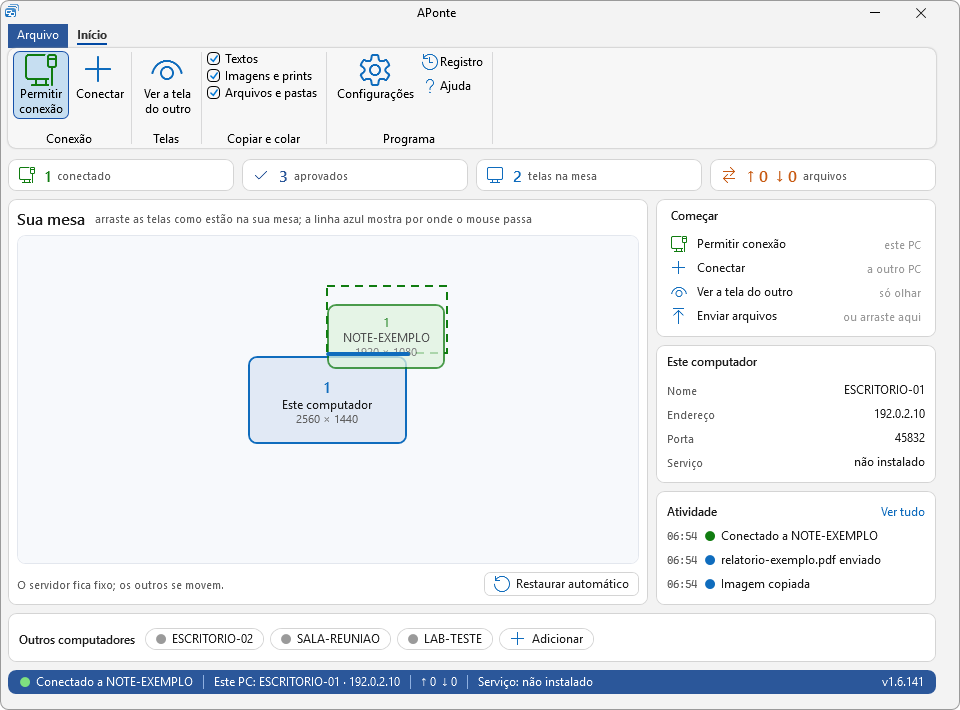 
  <b>Arrastando uma tela</b> para o lugar onde ela está na mesa. A linha azul mostra por onde o mouse passa.

  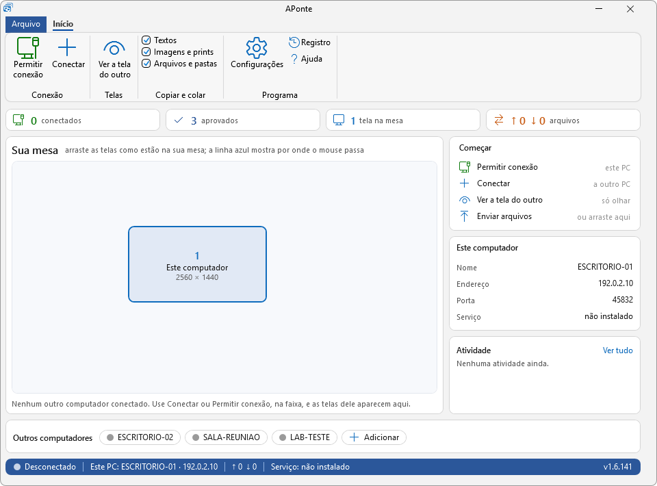 
  <b>Sem conexão</b>: os computadores já aprovados ficam a um clique, em <i>Outros computadores</i>.

  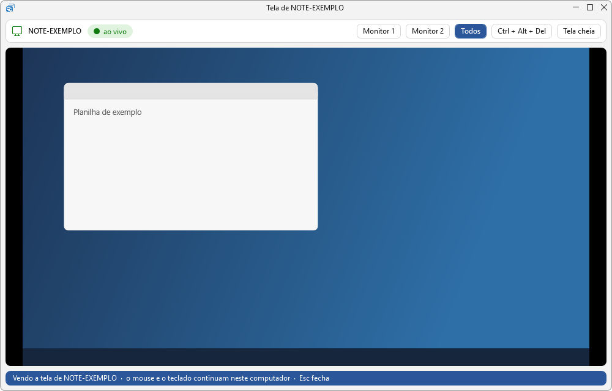 
  <b>Ver a tela do outro</b>: por monitor ou todos, com tela cheia.

| | |
|:---:|:---:|
| 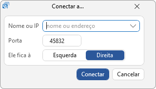 <b>Conectar</b>: nome ou endereço, porta e de que lado o outro fica. | 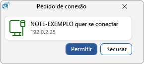 <b>Pedido de conexão</b>: só entra quem você permitir. |
| 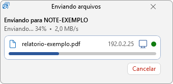 <b>Enviar arquivos</b> com andamento e velocidade. | 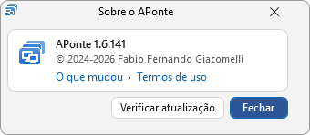 <b>Sobre</b>: versão, novidades, termos e verificação de atualização. |
| 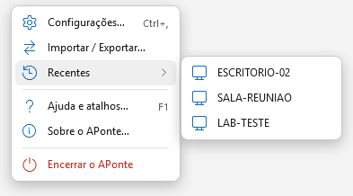 <b>Menu Arquivo</b> com os computadores recentes. | 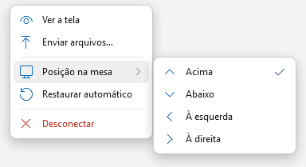 <b>Botão direito</b> numa tela da mesa. |
| 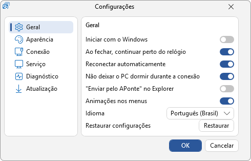 <b>Configurações › Geral</b> | 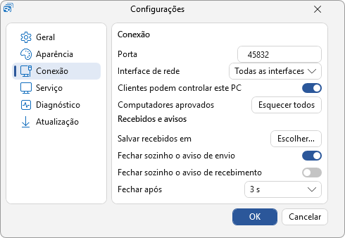 <b>Configurações › Conexão</b> |
| 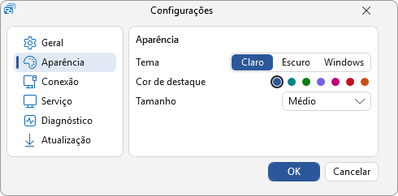 <b>Configurações › Aparência</b>: tema, cor e tamanho. | 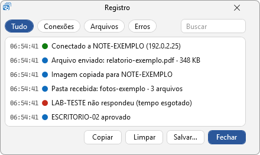 <b>Registro</b> com busca e filtros. |

## Requisitos

- Windows 10 ou 11 (64 bits).
- Computadores na mesma rede.
- [.NET Desktop Runtime 11 x64](https://dotnet.microsoft.com/download/dotnet/11.0), **somente** para os pacotes `sem-runtime`. Os pacotes `com-runtime` já incluem o .NET 11.

O instalador abre em português. Para inglês, execute `msiexec /i "arquivo.msi" TRANSFORMS=:1033`.

## Atualizações

- O APonte avisa quando há versão nova e faz a atualização (**Configurações › Atualização** ou **Sobre › Verificar atualização**). A verificação pode ser desligada nas Configurações.
- Atualizar mantém as configurações e os computadores aprovados.
- Se você usa a 1.6.125, 1.6.126 ou 1.6.127 com apenas o .NET 10, instale antes o [.NET Desktop Runtime 11 x64](https://dotnet.microsoft.com/download/dotnet/11.0) ou baixe o pacote `com-runtime` no mesmo formato que já usa.
- **Portátil, à mão:** feche o APonte, apague tudo na pasta dele, menos a pasta `dados`, e descompacte o pacote novo. Nunca descompacte por cima.
- O histórico completo de versões acompanha cada versão (`CHANGELOG.txt`; em inglês, `CHANGELOG.en.txt`).

## Segurança e privacidade

- **Rede local.** Os computadores conversam diretamente entre si, pela sua rede. Não há conta nem cadastro.
- **Aprovação.** Um computador novo só entra depois que você permite. Nome e endereço não bastam: cada computador tem uma identidade própria, que é conferida a cada conexão, e a conexão entre eles é cifrada.
- **Atualizações conferidas.** Antes de instalar uma versão nova, o APonte confere os pacotes por uma lista SHA-256 assinada pelo autor.
- **Seus dados ficam com você.** O APonte grava seus dados apenas na própria pasta e não envia informações ao autor. A verificação de versão nova consulta apenas o endereço público de publicação.

## Licença

**Uso gratuito, somente com autorização por escrito do autor.**
Peça a autorização **somente por e-mail** para **fabio.s91@icloud.com**, com o nome do app no assunto: **APonte**.
Empresas precisam de autorização própria. Não pode modificar, copiar para outras pessoas nem vender.
Uso sem autorização sujeita a multa e indenização. Termos de Uso completos em [LICENSE](LICENSE).

As bibliotecas de terceiros continuam regidas por suas próprias licenças, listadas na pasta `Licencas` de cada pacote.

## Autor

Fabio Fernando Giacomelli

© 2024-2026 Fabio Fernando Giacomelli. Todos os direitos reservados.
